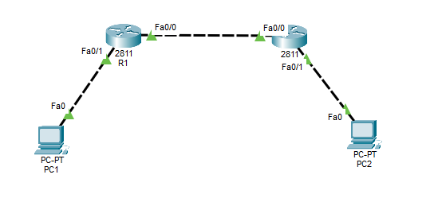
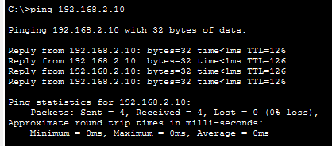
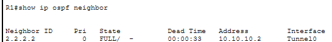
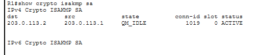
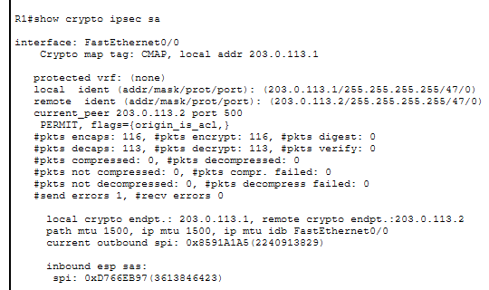
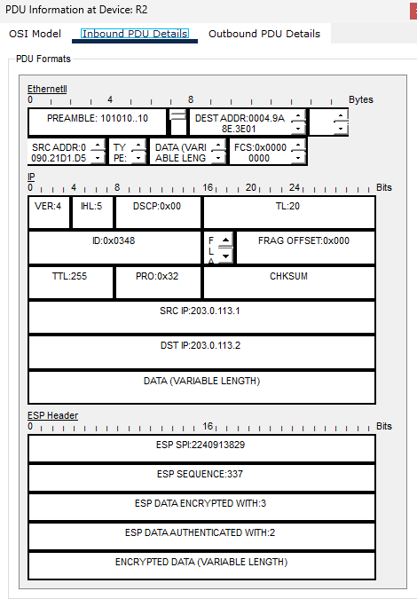

# Site-to-Site VPN: OSPF over GRE, Encrypted with IPsec

A two-site VPN built in Cisco Packet Tracer. A GRE tunnel carries OSPF between two private LANs, and IPsec encrypts the tunnel.

**Stack:** GRE (IP protocol 47) → IPsec (IKEv1, AES-256, SHA, DH group 5) → OSPF single-area



---

## Contents

- [The problem](#the-problem)
- [Topology and addressing](#topology-and-addressing)
- [How a packet travels](#how-a-packet-travels)
- [Build guide](#build-guide)
- [Verification](#verification)
- [Gotchas](#gotchas)
- [Troubleshooting](#troubleshooting)
- [Packet Tracer limitations](#packet-tracer-limitations)
- [Production notes](#production-notes)
- [Repository contents](#repository-contents)
- [Skills demonstrated](#skills-demonstrated)

---

## The problem

Two offices need to reach each other's private subnets across an untrusted network. They also need **dynamic routing**, because static routes break every time the topology changes.

Neither protocol solves this alone:

| | GRE | IPsec (crypto map) |
|---|---|---|
| Carries multicast | Yes | No |
| Supports routing protocols | Yes | No |
| Encrypts | No | Yes |

OSPF discovers neighbors with multicast (`224.0.0.5`). Classic crypto-map IPsec protects unicast only, so OSPF hellos never form an adjacency across it. GRE carries multicast, but sends everything in plaintext.

**Solution:** run OSPF inside GRE, then encrypt the GRE with IPsec. Each protocol covers the other's gap.

---

## Topology and addressing

```
   192.168.1.0/24                                      192.168.2.0/24
        PC1                                                  PC2
         |                                                    |
      f0/1|                                                |f0/1
      [ R1 ]------------ 203.0.113.0/30 ------------------[ R2 ]
      f0/0 .1                                          .2 f0/0
         |                                                    |
         +========= Tunnel0  10.10.10.0/30  ==================+
                    GRE over IPsec, OSPF area 0
```

| Device | Interface | Address | Role |
|---|---|---|---|
| R1 | Fa0/0 | 203.0.113.1/30 | Untrusted transit (underlay) |
| R1 | Fa0/1 | 192.168.1.1/24 | Site A LAN gateway |
| R1 | Tunnel0 | 10.10.10.1/30 | Tunnel endpoint (overlay) |
| R2 | Fa0/0 | 203.0.113.2/30 | Untrusted transit (underlay) |
| R2 | Fa0/1 | 192.168.2.1/24 | Site B LAN gateway |
| R2 | Tunnel0 | 10.10.10.2/30 | Tunnel endpoint (overlay) |
| PC1 | Fa0 | 192.168.1.10/24, gw 192.168.1.1 | Site A host |
| PC2 | Fa0 | 192.168.2.10/24, gw 192.168.2.1 | Site B host |

There are three separate subnets by design:

- **Underlay** (`203.0.113.0/30`) carries the tunnel.
- **Overlay** (`10.10.10.0/30`) is the tunnel itself.
- **LANs** ride inside the tunnel.

The underlay is deliberately **never advertised into OSPF**. It is transport, not part of the routing domain.

**Devices:** 2 × Cisco 2811 routers, 2 × PC-PT, copper cross-over cables.

---

## How a packet travels

1. PC1 sends to PC2: `192.168.1.10 → 192.168.2.10`.
2. R1 routes it out `Tunnel0` using its OSPF-learned route.
3. GRE encapsulates it: `[203.0.113.1 → 203.0.113.2][GRE][original packet]`.
4. The packet reaches `Fa0/0`, where the crypto map matches it against the ACL.
5. IPsec encrypts the GRE packet and forwards it as ESP.
6. R2 decrypts, strips GRE, and delivers the packet to PC2.

**GRE encapsulates first, IPsec encrypts second.** That is why the crypto map is applied to the physical interface rather than the tunnel, and why the crypto ACL matches GRE between the *physical* addresses.

---

## Build guide

The lab is built in three stages. Verify each one before moving on, so any fault is easy to isolate.

### Stage 1: Underlay

**R1**
```cisco
hostname R1
interface FastEthernet0/0
 ip address 203.0.113.1 255.255.255.252
 no shutdown
interface FastEthernet0/1
 ip address 192.168.1.1 255.255.255.0
 no shutdown
```

**R2**
```cisco
hostname R2
interface FastEthernet0/0
 ip address 203.0.113.2 255.255.255.252
 no shutdown
interface FastEthernet0/1
 ip address 192.168.2.1 255.255.255.0
 no shutdown
```

Check: `ping 203.0.113.2` from R1 succeeds.

### Stage 2: GRE tunnel and OSPF

**R1**
```cisco
interface Tunnel0
 ip address 10.10.10.1 255.255.255.252
 tunnel source FastEthernet0/0
 tunnel destination 203.0.113.2
 no shutdown
router ospf 1
 router-id 1.1.1.1
 network 10.10.10.0 0.0.0.3 area 0
 network 192.168.1.0 0.0.0.255 area 0
 passive-interface FastEthernet0/1
```

**R2**
```cisco
interface Tunnel0
 ip address 10.10.10.2 255.255.255.252
 tunnel source FastEthernet0/0
 tunnel destination 203.0.113.1
 no shutdown
router ospf 1
 router-id 2.2.2.2
 network 10.10.10.0 0.0.0.3 area 0
 network 192.168.2.0 0.0.0.255 area 0
 passive-interface FastEthernet0/1
```

Check: `show ip ospf neighbor` shows `FULL/ -`, and PC1 can ping PC2. At this point the traffic works but is **not encrypted**.

### Stage 3: IPsec over GRE

**R1**
```cisco
! IKE Phase 1
crypto isakmp policy 10
 encr aes 256
 hash sha
 authentication pre-share
 group 5
 lifetime 86400
 exit
crypto isakmp key SecureKey123 address 203.0.113.2
!
! IKE Phase 2
crypto ipsec transform-set TS esp-aes 256 esp-sha-hmac
!
! Interesting traffic: GRE between the physical endpoints
ip access-list extended VPN-TRAFFIC
 permit gre host 203.0.113.1 host 203.0.113.2
 exit
crypto map CMAP 10 ipsec-isakmp
 set peer 203.0.113.2
 set transform-set TS
 match address VPN-TRAFFIC
 exit
interface FastEthernet0/0
 crypto map CMAP
```

**R2** is identical, with the peer addresses and the crypto ACL reversed:
```cisco
crypto isakmp policy 10
 encr aes 256
 hash sha
 authentication pre-share
 group 5
 lifetime 86400
 exit
crypto isakmp key SecureKey123 address 203.0.113.1
crypto ipsec transform-set TS esp-aes 256 esp-sha-hmac
ip access-list extended VPN-TRAFFIC
 permit gre host 203.0.113.2 host 203.0.113.1
 exit
crypto map CMAP 10 ipsec-isakmp
 set peer 203.0.113.1
 set transform-set TS
 match address VPN-TRAFFIC
 exit
interface FastEthernet0/0
 crypto map CMAP
```

> Do not type `exit` right after the `transform-set` line in Packet Tracer. It does not enter a sub-mode there, so `exit` would drop you out of configuration mode.

The full lab is also saved as a Packet Tracer file: [`GRE_001.pkt`](GRE_001.pkt).

---

## Verification

Do not trust a successful ping alone. A GRE tunnel with a broken crypto ACL pings perfectly and encrypts nothing. Confirm encryption from the SA state and counters.

### 1. End-to-end connectivity

PC1 reaches PC2 across the tunnel with no loss. `TTL=126` confirms the packet crossed two routers.



### 2. OSPF adjacency over the tunnel

```
R1#show ip ospf neighbor
Neighbor ID     Pri   State      Dead Time   Address       Interface
2.2.2.2           0   FULL/  -   00:00:33    10.10.10.2    Tunnel0
```



A multicast routing protocol is running over an encrypted tunnel, which is the result the whole design exists for. `FULL/ -` shows no DR/BDR election, because GRE tunnels are point-to-point by default.

### 3. IKE Phase 1 established

```
R1#show crypto isakmp sa
dst           src           state     conn-id  slot  status
203.0.113.2   203.0.113.1   QM_IDLE   1019     0     ACTIVE
```



`QM_IDLE` means Phase 1 completed and is ready. Idle here indicates health, not a stall.

### 4. IKE Phase 2 encrypting



Three things confirm success:

- **`prot 47`** in both ident lines: the protected traffic is GRE, so IPsec is wrapping the tunnel as intended.
- **`origin_is_acl`**: the SA was built from the crypto ACL, so the ACL matched.
- **`#pkts encaps` and `#pkts decaps` both increasing**: traffic is encrypted and decrypted in both directions.

`#send errors 1` is the first packet, dropped while the SA negotiated. IPsec builds on demand, so the first packet is always lost. `#pkts digest` and `#pkts verify` stay at 0 in Packet Tracer; that is a display quirk.

### 5. ESP on the wire

Simulation mode, inbound PDU on R2:



- `PRO:0x32` is IP protocol 50 (ESP).
- The outer IPs are only the physical addresses (`203.0.113.1 → 203.0.113.2`). The LAN addresses are hidden in the encrypted payload.
- The ESP SPI (`2240913829`) matches the outbound SPI (`0x8591A1A5`) from `show crypto ipsec sa` on R1.

---

## Gotchas

**The crypto ACL must match GRE between the physical IPs.** The instinctive `permit ip 192.168.1.0 0.0.0.255 192.168.2.0 0.0.0.255` matches nothing. By the time IPsec inspects the packet, GRE has already rewritten the header and the LAN addresses are buried in the payload. The result is a tunnel that works and encrypts nothing. Only the encaps counters reveal it.

**The crypto map goes on the physical interface.** Applying it to `Tunnel0` places the check before encapsulation, when the packet does not yet look like GRE, so the ACL never matches.

**Phase 1 parameters must match exactly.** Encryption, hash, authentication method, and DH group all have to agree. A single mismatch causes a silent failure with no useful error message.

**Do not advertise the transit link into OSPF.** Advertising `203.0.113.0/30` can cause recursive routing, where the tunnel tries to reach its own destination through itself and flaps.

---

## Troubleshooting

| Symptom | Likely cause | Check |
|---|---|---|
| Tunnel0 `up/up` but no OSPF neighbor | Underlay unreachable or wrong tunnel destination | `ping 203.0.113.2`, `show interface Tunnel0` |
| Ping works, encaps stay at 0 | Crypto ACL not matching (wrong addresses or protocol) | `show access-lists`, `show crypto ipsec sa` |
| No ISAKMP SA | Phase 1 mismatch or wrong pre-shared key or peer | `show crypto isakmp policy`, compare both routers |
| ISAKMP up, no IPsec SA | Transform-set mismatch or crypto map not applied | `show crypto ipsec transform-set`, `show crypto map` |
| OSPF flaps | Transit link advertised into OSPF (recursive routing) | `show ip route`, check `network` statements |
| First ping times out | Normal: ARP plus SA negotiation | Ping again |

---

## Packet Tracer limitations

Two places where the simulator differs from real IOS:

**Transport mode is unavailable.** GRE over IPsec should use `mode transport`, since GRE has already added an outer IP header and tunnel mode adds a redundant third. Packet Tracer does not enter the transform-set sub-mode, so this lab runs in the default tunnel mode, costing 20 extra bytes per packet.

**The 2911 router cannot be used.** It needs `license boot module c2900 technology-package securityk9` before crypto commands work, and that command does not persist in Packet Tracer. This lab uses **2811 routers**, which run IOS 12.4 and predate technology-package licensing.

---

## Production notes

This is a learning lab. For a real deployment:

- Use **transport mode** for GRE over IPsec.
- Prefer **IKEv2** and an **IPsec profile with `tunnel protection`** instead of a crypto map, so no crypto ACL is needed.
- Use a strong, unique pre-shared key (or certificates), not the lab key shown here.
- Set `ip mtu` and `ip tcp adjust-mss` on the tunnel to account for GRE and ESP overhead.

---

## Repository contents

| File | Description |
|---|---|
| `GRE_001.pkt` | Cisco Packet Tracer lab file |
| `topology.png` | Lab topology |
| `ping.png` | End-to-end ping through the tunnel |
| `ospf-neighbor.png` | OSPF adjacency on Tunnel0 |
| `isakmp-sa.png` | IKE Phase 1 state |
| `ipsec-sa.png` | IPsec SA with encaps/decaps counters |
| `simulation-esp.png` | ESP packet captured in Simulation mode |

**To run it:** open `GRE_001.pkt` in Cisco Packet Tracer, ping `192.168.2.10` from PC1, then run the verification commands on R1.

---

## Skills demonstrated

- GRE tunnel design and the underlay/overlay distinction
- IKE Phase 1 and Phase 2 negotiation and how they differ
- Crypto ACLs as traffic classifiers rather than filters
- Why encapsulation order decides where the crypto map is applied
- OSPF over a tunnel interface, including point-to-point neighbor behavior
- Verifying encryption from SA state, counters and packet captures instead of assuming a successful ping means success
- Staged build and verify methodology, plus troubleshooting

---

**Author:** Pramith ([@PRAMITH-25](https://github.com/PRAMITH-25))
